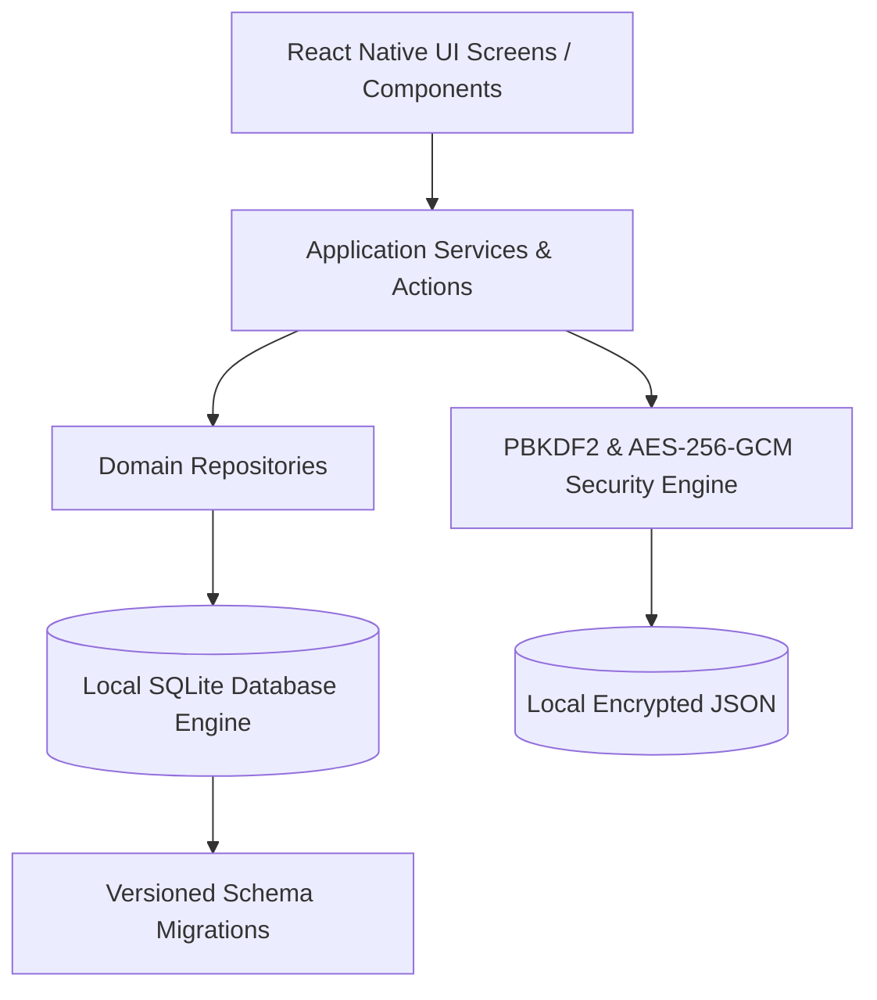
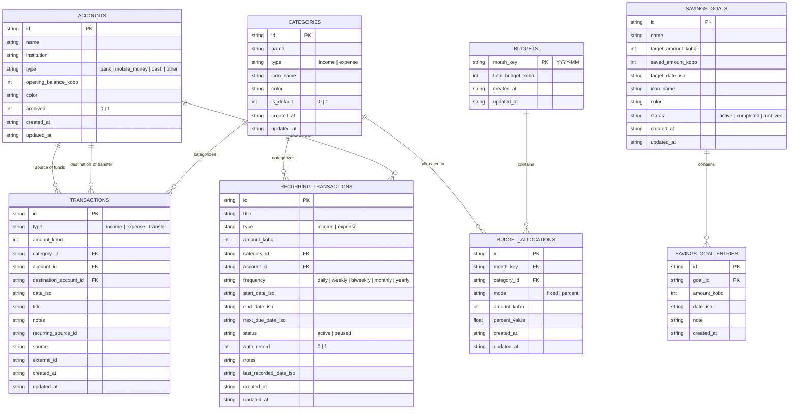

# Kobbi System Architecture & Engineering Specification

This document provides a technical overview of the Kobbi React Native mobile application for software architects, fintech engineers, and security reviewers.

---

## 1. High-Level Architecture

Kobbi is designed as an **offline-first local financial operating system**. The application follows a unidirectional data flow pattern where SQLite is the authoritative source of truth.

---

## 2. Database Schema & Entity Relationship Model

All entities use stable UUID v4 primary keys and ISO-8601 timestamps (`YYYY-MM-DDTHH:mm:ss`).

---

## 3. Financial Calculation Guarantees

### 3.1 Integer-Kobo Minor Units Invariant
In accordance with fintech engineering best practices:
- Standard JavaScript numbers (`IEEE 754 floating point`) cannot accurately represent decimals like `0.1 + 0.2 = 0.30000000000000004`.
- In Kobbi, **all amounts are represented strictly in integer minor units (kobo)**:
  $$\text{Amount (kobo)} = \text{Amount (Naira)} \times 100$$
- Input parsing uses string splitting (`parseNairaInputToKobo`) to avoid floating multiplication drift.
- Percentage allocations are calculated using integer basis points:
  $$\text{Allocated Kobo} = \left\lfloor \frac{\text{Total Budget Kobo} \times (\text{Percent} \times 100)}{10,000} \right\rceil$$

### 3.2 Account Balance Invariant
Account balances are never stored as independently mutable scalar values. A given account's current balance is mathematically determined by its ledger history:
$$\text{Balance}_A = \text{OpeningBalance}_A + \sum_{T \in \text{Income}_A} T_{\text{amt}} - \sum_{T \in \text{Expense}_A} T_{\text{amt}} + \sum_{T \in \text{TransferTo}_A} T_{\text{amt}} - \sum_{T \in \text{TransferFrom}_A} T_{\text{amt}}$$

This ensures that account balances are deterministic, reproducible, and verifiable at all times.

---

## 4. Cryptography & Security Model

### 4.1 PIN Storage & Authentication
- **Algorithm**: PBKDF2 with HMAC-SHA256.
- **Iterations**: 50,000 rounds.
- **Salt**: 16 cryptographically secure random bytes generated using `@noble/hashes/utils.js`.
- **Output Key Length**: 32 bytes (256 bits).
- When a PIN is configured, only the resulting hexadecimal hash and salt are stored in the local SQLite `app_settings` table. The raw PIN is never persisted to disk.

### 4.2 Encrypted JSON Backups
When exporting backups with user-supplied passwords:
- **Cipher**: AES-256-GCM (Galois/Counter Mode).
- **Key Derivation**: PBKDF2-HMAC-SHA256 with 100,000 rounds and a 16-byte random salt.
- **Nonce / IV**: 12 cryptographically random bytes.
- **Authentication**: GCM provides built-in authenticated encryption. Any tampering or incorrect password immediately causes decryption to fail before touching database state.

---

## 5. Recurrence & Calendar Boundary Handlers

To avoid standard JavaScript date bugs where `dt.setMonth(dt.getMonth() + 1)` on January 31 rolls into March:
- The recurrence engine clamps dates to the maximum valid days in the destination month:
  - `2023-01-31` + 1 Month $\rightarrow$ `2023-02-28`
  - `2024-02-29` (Leap Day) + 1 Year $\rightarrow$ `2025-02-28`
  - `2026-08-31` + 1 Month $\rightarrow$ `2026-09-30`

---

## 6. Disaster Recovery & Database Restoration

Restoration operations are executed inside an SQLite transaction with `BEGIN IMMEDIATE`:
1. If parsing or cryptographic authentication fails, the transaction is never started.
2. If any table insert fails (e.g. foreign key violation), the database rolls back completely to its pre-restore state.
3. Successful restorations atomically clear and populate tables, maintaining referential integrity.
